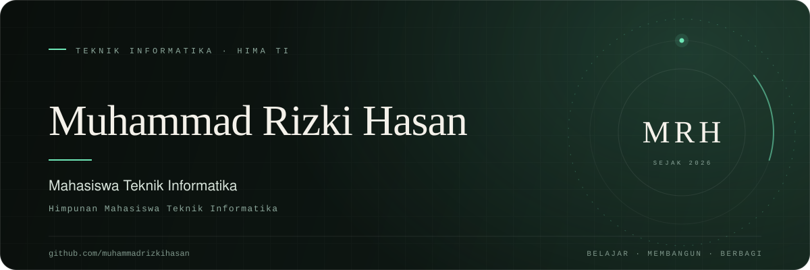

  

## Tentang

Saya **Muhammad Rizki Hasan**, mahasiswa **Teknik Informatika** dan bagian dari **HIMA TI**. Saya percaya cara terbaik untuk belajar adalah dengan membangun: membaca secukupnya, menulis kode, lalu memperbaiki apa yang belum selesai.

Saat ini saya memusatkan perhatian pada fondasi ilmu komputer, web development, dan kebiasaan menulis kode yang rapi. Pekerjaan yang baik, bagi saya, lahir dari rasa ingin tahu yang dijaga dan kemauan untuk terus memperbaiki.

<!-- TODO: lengkapi kampus, angkatan, dan kota sebelum publish. -->

> **Nama** — Muhammad Rizki Hasan 
> **Pendidikan** — Mahasiswa Teknik Informatika 
> **Organisasi** — HIMA TI — Himpunan Mahasiswa Teknik Informatika 
> **Lokasi** — Indonesia 
> **Status** — Terbuka untuk kolaborasi dan belajar bersama 
> **Kontak** — [muhammadrizkihasan88@gmail.com](mailto:muhammadrizkihasan88@gmail.com)

## Fokus

**01 · Dasar ilmu komputer** — Algoritma, struktur data, dan cara memecah masalah menjadi langkah-langkah kecil.

**02 · Web development** — Membangun antarmuka yang bersih, aksesibel, dan nyaman digunakan.

**03 · Kebiasaan engineering** — Git, dokumentasi, dan kode yang bisa dibaca orang lain, termasuk diri saya enam bulan lagi.

## Yang sedang dituju

- [x] Memulai perjalanan di GitHub dan mendokumentasikannya
- [ ] Menyelesaikan satu proyek dari awal sampai akhir
- [ ] Berkontribusi pada proyek open source
- [ ] Menulis catatan belajar secara rutin

## Prinsip

- **Selesai lebih baik daripada sempurna.** Versi pertama tidak harus bagus; yang penting ada, lalu diperbaiki.
- **Sederhana itu sulit.** Solusi terbaik biasanya yang paling mudah dijelaskan.
- **Dokumentasi adalah bagian dari pekerjaan.** Kode yang baik bercerita, catatan yang baik menyelamatkan.

## Terhubung

Terbuka untuk diskusi, kolaborasi, atau sekadar bertukar pikiran. Email adalah cara tercepat untuk menghubungi saya.

  
  &nbsp;
  

---

  Terima kasih sudah mampir · © 2026 Muhammad Rizki Hasan

